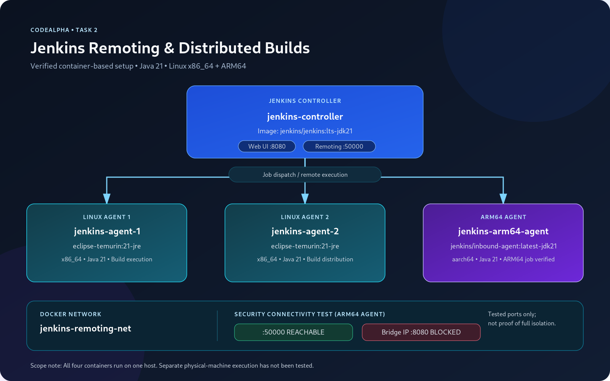
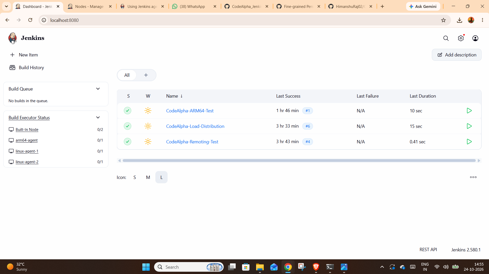
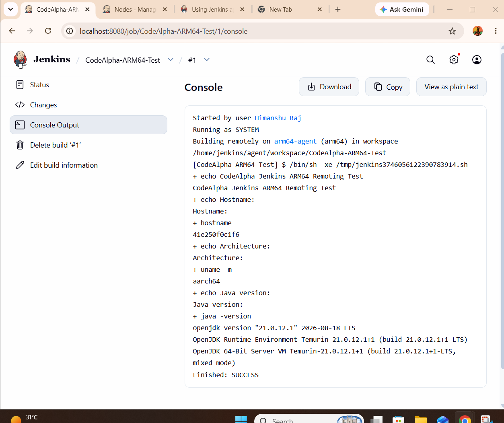

# Jenkins Remoting Project | CodeAlpha

A hands-on DevOps project demonstrating Jenkins Remoting, distributed builds, Linux agents, ARM64 remote execution, and network connectivity testing using Docker.

## Project Overview

The project uses a Jenkins Controller connected to multiple Jenkins agents. Jobs can run on different configured agents, and build execution can be verified through Jenkins console output.

## Objectives

- Configure Jenkins Remoting with remote agents.
- Distribute builds across Linux agents.
- Execute a job on an ARM64 agent.
- Test network connectivity between Jenkins components.
- Document verification results and security limitations.

## Architecture

The following diagram illustrates the project architecture and tested setup.



The Jenkins controller runs locally in Docker. Linux and ARM64 agents were used for distributed execution tests, and an AWS EC2 Ubuntu VM was connected as a remote Jenkins agent. The EC2 agent completed a successful remote build.

## Environment

| Component | Configuration |
|---|---|
| Jenkins Controller | Docker container |
| Linux Agents | Two Linux agent containers |
| ARM64 Agent | ARM64 container using Java 21 |
| Networking | Dedicated Docker network, plus SSH reverse tunnel to the AWS EC2 agent |
| Build execution | Jenkins Remoting |
| Evidence | Screenshots and verification scripts |

## Verified Results

- Jenkins Controller and Linux agents configured.
- Remote execution test completed successfully.
- Load distribution verified: Build #5 ran on `jenkins-agent-2` and Build #6 ran on `jenkins-agent-1`.
- ARM64 job completed successfully and reported `aarch64`.
- Environment and agent verification scripts executed.
- AWS EC2 Ubuntu agent connected through an SSH reverse tunnel; the Jenkins controller endpoint returned HTTP 200 through the tunnel.
- Captured TCP traffic on EC2 and correlated the observed external destination IP with the local network's public IP.
- Evidence screenshots saved for agent status, remote build, packet capture, tunnel connectivity, and container security settings.

## Evidence

### Jenkins Dashboard — Successful Jobs and Agents



### ARM64 Remote Build



## Verification Scripts

The repository includes scripts for checking the environment and Linux agents.

- [Verify Environment Script](scripts/verify-environment.sh)
- [Verify Agents Script](scripts/verify-agents.sh)

To inspect or run a script from the project directory:

```bash
cat scripts/verify-environment.sh
cat scripts/verify-agents.sh
```

Run the scripts in an environment where their required commands and Docker access are available.

## Repository Links

- [Architecture and Documentation — docs](docs/)
- [All Evidence Screenshots — evidence](evidence/)
- [Verification Scripts — scripts](scripts/)
- [Project Source and README](.)

## Security Testing and Limitations

Network connectivity tests were performed from the configured containers. The recorded test showed the Jenkins Remoting port `50000` was reachable, while the tested connection to the controller's other network address on port `8080` was blocked.

These results apply only to the tested source, destination, ports, and network configuration; they do not prove complete node isolation. The AWS EC2 Ubuntu VM is a separate cloud virtual machine, not a second physical laptop or server. The SSH reverse tunnel and successful remote build demonstrate controller-to-agent connectivity across the local host and AWS VM.

## Project Status

The local Docker-based Jenkins Remoting setup, Linux load-distribution test, ARM64 build, AWS EC2 remote-agent build, SSH tunnel connectivity check, and TCP packet capture have been completed. Complete network isolation has not been established by these tests.

---

**Author:** Himanshu Raj  
**Program:** CodeAlpha DevOps Internship  
**Project:** Jenkins Remoting
